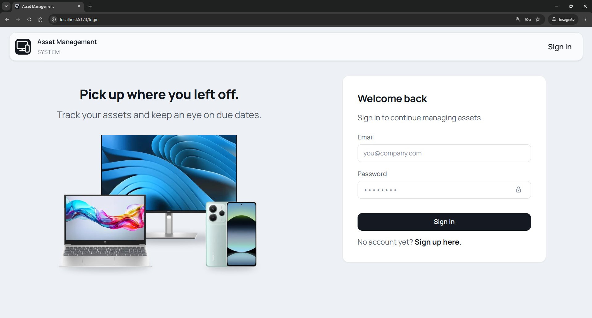
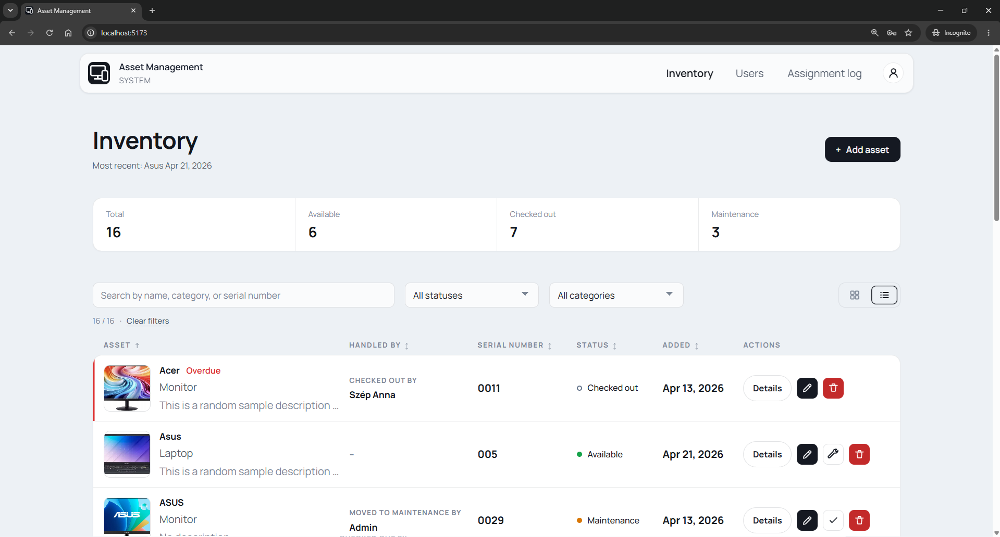
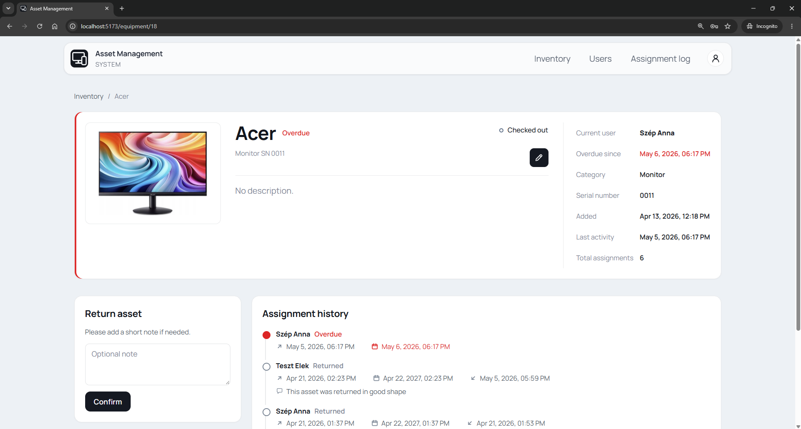
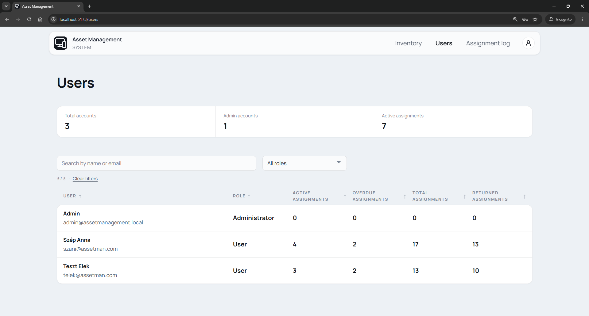
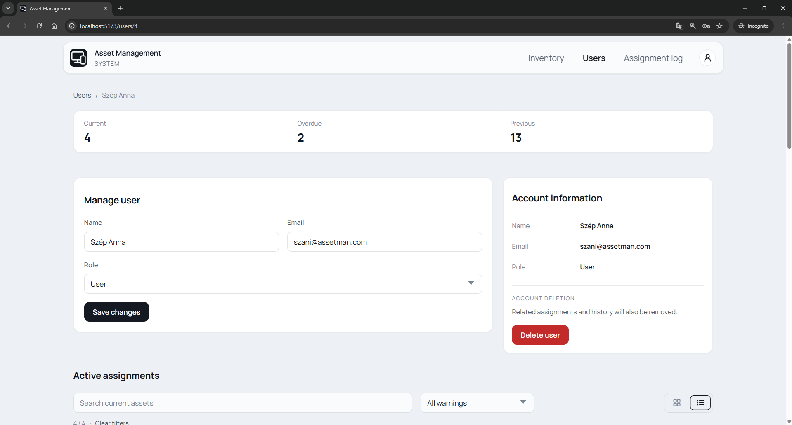
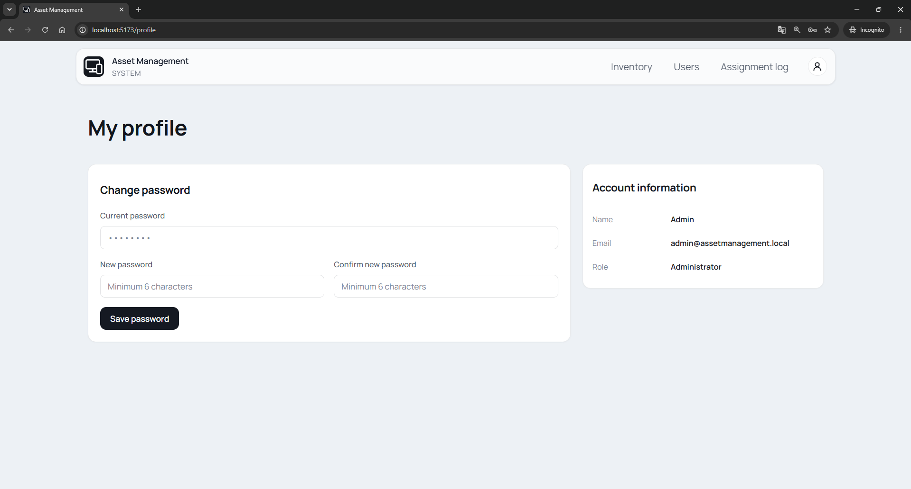
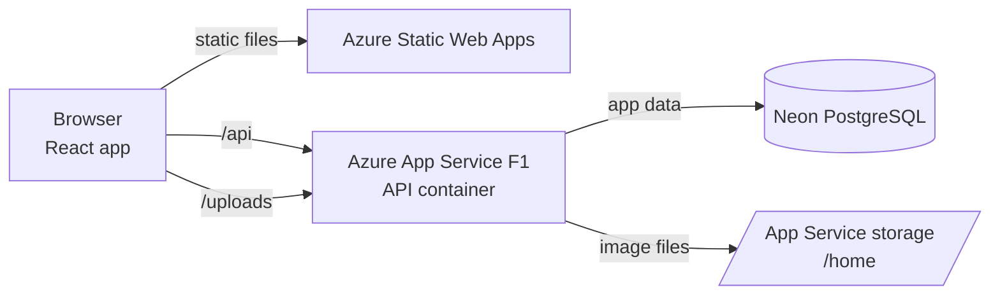
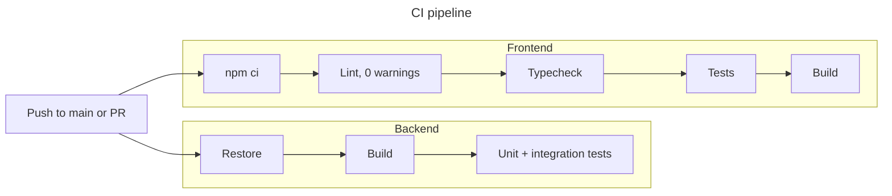

# Asset Management System

[](https://github.com/20davo/asset-management-system/actions/workflows/ci.yml)


This full-stack portfolio project is designed for smaller IT teams as an internal asset tracker. It is meant for those who have outgrown spreadsheets but do not need a full enterprise tool.

## Demo

You can try the app in a [demo environment](https://www.assetmanagement-demo.hu), which is deployed on Azure.

To sign in quickly, use the **Demo admin** or **Demo user** accounts. You can also create your own account.

A few things to know:

- All data is sample data, and it is reset daily.
- The demo accounts cannot be changed or deleted.
- The demo runs on free tiers. After some idle time, the first request can take a few seconds while the server wakes up.
- If the free daily limits are used up, the API is unavailable until midnight UTC.

| Login | Inventory |
| --- | --- |
|  |  |

<details>
<summary>More pages</summary>









</details>

## Features

- Sign-in with two roles (admin and regular user)
- Self-registration for regular users (can be disabled per environment)
- Searching, filtering, and sorting across the app's lists
- Card and list views on the main list pages
- List settings (search, filters, sorting, and view) persist after page refresh and can be shared via URL
- Checkout and return process with due dates and notes, plus assignment history
- Admin tools for creating, editing, deleting assets, and setting maintenance status
- An Assignments page for admins
- User management for admins, including data and role editing
- A personal My Assets page for users
- Password change on the Profile page
- Asset image uploads via create/edit forms
- Settings for language (English and Hungarian) and theme (light and dark)

## Architecture

The diagram shows the **demo setup**. The React app runs in the browser and calls the ASP.NET Core REST API. After sign-in, it sends a JWT with every request.



### Project structure

Each **backend** request goes through a thin controller to a service layer behind interfaces, which uses EF Core with PostgreSQL. The API returns DTOs or short result codes. EF entities are only used inside the API.

The **frontend** uses React Router, and pages that need sign-in are wrapped in a protected route. All `/api` calls go through one Axios client. It adds the token and handles 401 and 403 responses. Auth, language, and theme state are kept in React contexts.

The **data model** has three entities (User, Equipment, Checkout). A checkout record links one user and one equipment item, and it is active while its return date is empty. An item can be *available*, *checked out*, or in *maintenance*.

```text
api/AssetManagement/      ASP.NET Core solution (API project and two test projects)
frontend/                 React + TypeScript app (Vite)
compose.yaml              local development setup
compose.prod.yaml         production-like overrides (Nginx, no exposed API/DB ports)
compose.demo.yaml         demo setup with a separate database
.github/workflows/ci.yml  CI pipeline with automated tests
.github/workflows/cd.yml  CD pipeline for manual demo deployment
```

### Demo deployment

The Azure demo runs the API in the `Demo` environment (`appsettings.Demo.json`). In this mode, the API loads sample data, resets it on startup if it is more than a day old, and protects the demo accounts.

The [CD workflow](./.github/workflows/cd.yml) is triggered manually. It builds the API image, pushes it to GitHub Container Registry, and deploys it to Azure App Service. Then it deploys the frontend and runs a short smoke test. The API deployment authenticates with Azure through OpenID Connect (OIDC).

## API overview

The API serves JSON under `/api` with JWT Bearer authentication. You can try all endpoints in the demo's [Swagger UI](https://ams-demo-api-f6g3hvfudcgaajd2.germanywestcentral-01.azurewebsites.net/swagger), or locally at `http://localhost:5071/swagger`. In the API, `checkout` means an assignment record.

<details>
<summary>Endpoint reference</summary>

### Authentication

| Method | Endpoint | Access | Purpose |
| --- | --- | --- | --- |
| `POST` | `/api/auth/register` | Public when enabled | Register a regular user |
| `POST` | `/api/auth/login` | Public | Sign in and receive a JWT |
| `POST` | `/api/auth/change-password` | Signed-in users | Change the current user's password |

### Equipment

| Method | Endpoint | Access | Purpose |
| --- | --- | --- | --- |
| `GET` | `/api/equipment` | Signed-in users | List inventory items |
| `GET` | `/api/equipment/{id}` | Signed-in users | Get asset details |
| `POST` | `/api/equipment` | Admin | Create an asset, optionally with an image |
| `PUT` | `/api/equipment/{id}` | Admin | Update asset details, and replace or remove the image |
| `DELETE` | `/api/equipment/{id}` | Admin | Delete an asset if it is not assigned |
| `POST` | `/api/equipment/{id}/checkout` | Signed-in users | Create an asset assignment |
| `POST` | `/api/equipment/{id}/return` | Assigned user or admin | Return an asset and close the assignment |
| `POST` | `/api/equipment/{id}/mark-maintenance` | Admin | Move an available asset to maintenance |
| `POST` | `/api/equipment/{id}/mark-available` | Admin | Move a maintenance asset back to available |
| `GET` | `/uploads/equipment/{fileName}` | Signed-in users | Load a protected equipment image |

### Asset assignments

| Method | Endpoint | Access | Purpose |
| --- | --- | --- | --- |
| `GET` | `/api/checkout` | Admin | List all assignment records |
| `GET` | `/api/checkout/{id}` | Admin | Get one assignment record |
| `GET` | `/api/checkout/user/{userId}` | Admin | List a user's assignment history |
| `GET` | `/api/checkout/my` | Signed-in users | List the current user's assignment history |

### Users

| Method | Endpoint | Access | Purpose |
| --- | --- | --- | --- |
| `GET` | `/api/users` | Admin | List users |
| `GET` | `/api/users/{id}` | Admin | Get one user |
| `PUT` | `/api/users/{id}` | Admin | Update name, email, and role |
| `DELETE` | `/api/users/{id}` | Admin | Delete a user and their assignment records |

</details>

Some rules the API checks beyond the access levels:

- Admins cannot delete their own account or remove their own admin role.
- The last admin cannot be deleted or lose the admin role.
- Assets with an active assignment cannot be deleted.
- Admins can assign assets only to regular users.

## Tests and CI



The CI pipeline runs three groups of tests:

- **Backend, 30 unit tests (xUnit).** Mostly controller-level tests using an in-memory EF Core database. They cover auth rules, the equipment and checkout lifecycles, user management edge cases such as last-admin protection, the JWT key check, and the upload folder setting.
- **Backend, 3 integration tests.** Full HTTP tests against a real PostgreSQL container via Testcontainers. They cover the concurrent checkout race, the duplicate-registration race, and token invalidation on password change.
- **Frontend, 25 Vitest tests.** They cover API error and message mapping, the success and error message component, the asset form, the page `lang` attribute, and the English and Hungarian texts (same keys, no empty texts). The component tests use Testing Library.

## Getting started

You need Docker Desktop (or Docker Engine with Compose). All settings are documented in [.env.example](./.env.example).

```sh
# create .env from the example with a random JWT key
sed "s|^JWT_KEY=.*|JWT_KEY=$(openssl rand -base64 48)|" .env.example > .env

# build and start the app in development mode
docker compose up --build -d
```

Open `http://localhost:5173`. In development mode, the app starts with an empty database and a bootstrap admin account:

- email: `admin@assetmanagement.local`
- password: `Admin123!`

To run the app with sample data, start the demo mode with `docker compose -f compose.demo.yaml up --build -d` and open `http://localhost:5174`.

## Known limitations

Some production decisions in this portfolio project are kept simple on purpose. These are the trade-offs I know about and the direction I would take next:

| Current state | Production direction |
| --- | --- |
| JWT stored in browser `localStorage` | Secure `HttpOnly` cookies |
| Two fixed roles (admin, user) | Policy-based authorization for finer permissions |
| Deleting a user or an asset also deletes its assignment history | Deactivate users and archive assets, and keep their history |
| IP-based login rate limiting | Add per-account lockout rules |
| EF Core migrations run on startup | A separate migration step in the CD workflow, with database backups |
| Uploads stored on the API server's disk | Object storage with scanning and backups |
| Secrets are environment variables (`.env` locally, App Service settings in the demo) | A secret manager, such as Azure Key Vault |
| Unit tests plus API integration tests | Frontend end-to-end coverage |
| No monitoring | Structured logs, health checks, metrics, error tracking |

## License

This repository is public for review as a portfolio project, but it is not released as open-source software. See [LICENSE](./LICENSE).
